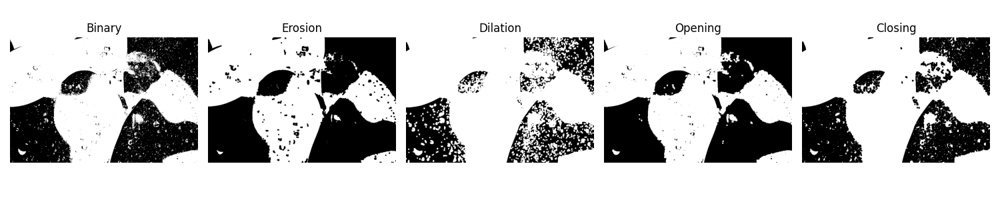
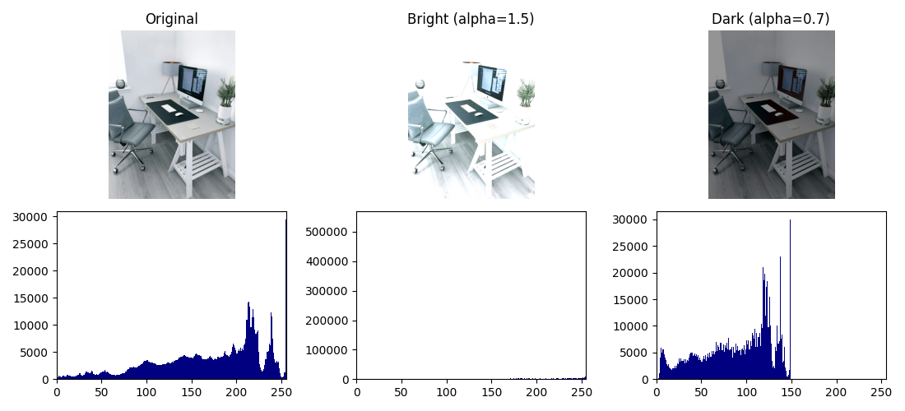
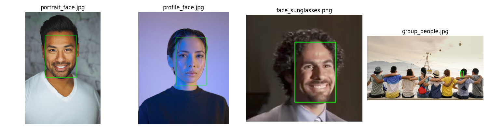
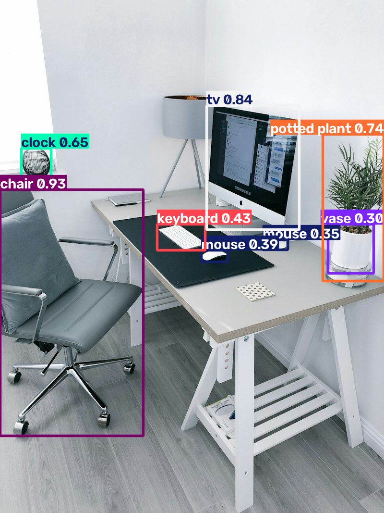
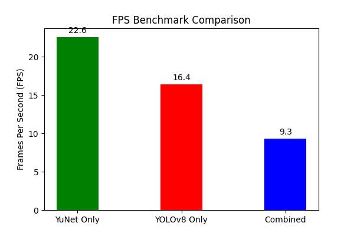
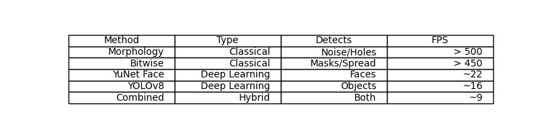

# Classical Image Processing to Real-Time Deep Learning Object Detection Pipeline (CV PR 3)

**Red & White Skill Education — Deep Learning Practical 3**  
*Integrated Computer Vision Pipeline: Classical Morphology, Bitwise Logic, Histograms, YuNet Face Detection, and YOLOv8 Object Detection*

---

## 📌 Project Overview
This project presents an end-to-end computer vision pipeline bridging classical pixel-level image processing techniques with modern deep-learning-based detectors. Designed for resource-efficient smart surveillance, workplace monitoring, and privacy filtering, the system combines lightweight morphological cleaning and bitwise region-of-interest extraction with OpenCV's bundled YuNet face detector and Ultralytics YOLOv8-Nano object detector on custom realistic datasets and live laptop camera streams.

---

## 🎥 Video Explanation & Live Demonstration
- **Video Title**: `CV_PR3_StudentName_GRID.mp4`
- **Format**: MP4, 1080p, Face (Webcam Picture-in-Picture) + Screen Recording
- **Duration**: ~7 Minutes
- **Video Link**: [Watch Full Project Walkthrough & Live Demo on Google Drive / YouTube](#) *(Paste your Google Drive or unlisted YouTube link here)*

---

## 🛠️ Tools & Frameworks
| Category | Framework / Tool | Version | Purpose |
|---|---|---|---|
| **Core CV** | OpenCV (`cv2`, `opencv-contrib-python`) | `5.0.0.93` | Classical image processing, I/O, YuNet face detector |
| **Deep Learning** | Ultralytics YOLOv8 (`ultralytics`) | `8.4.191` | Real-time multi-class object detection (COCO 80 classes) |
| **Tensor Backend** | PyTorch (`torch`, `torchvision`) | `2.14.1` | Neural network runtime for YOLOv8 |
| **Numerical** | NumPy (`numpy`) | `2.2.6` | Array manipulation, structuring element kernels, masking |
| **Visualization** | Matplotlib (`matplotlib`) | `3.8.4` | Inline plotting, histogram analysis, evaluation tables |
| **Notebook Runtime** | Jupyter / nbconvert | Python 3.10 | Interactive execution, documentation, and HTML export |

---

## 📦 Data & Pretrained Model Sources
1. **Custom Realistic Image Dataset**:
   - `texture_surface.jpg`: High-resolution photograph of a textured surface used for Otsu binarization and morphological structuring element experiments.
   - `indoor_desk.jpg`: Workplace desk photo containing multiple everyday objects (keyboard, mouse, TV/monitor, chair, potted plant, vase).
   - `fruits.jpg`: Vibrant multi-color object image used for 3-channel BGR histogram analysis.
   - `portrait_face.jpg`: Clear front-facing real portrait photograph for YuNet face detection and privacy blurring.
   - `profile_face.jpg`: Real human face in severe side-profile orientation to test angular robustness.
   - `faces/face_sunglasses.png`: Photograph of an individual wearing sunglasses to evaluate partial facial occlusion handling.
   - `group_people.jpg`: Real multi-person indoor setting used for multi-face detection, NMS duplicate suppression, and the integrated pipeline.
2. **YuNet Face Detector Weights**:
   - `face_detection_yunet_2023mar.onnx` from OpenCV Zoo: [https://github.com/opencv/opencv_zoo](https://github.com/opencv/opencv_zoo)
3. **YOLOv8 Pretrained Weights**:
   - `yolov8n.pt` from Ultralytics Releases: [https://github.com/ultralytics/assets/releases](https://github.com/ultralytics/assets/releases) (Pre-trained on COCO dataset, 80 classes).

---

## ⚙️ Environment Setup & Installation

```bash
# 1. Clone repository (do NOT push until approved)
git clone <your-repo-url>
cd CV_PR3

# 2. Install dependencies via requirements.txt
pip install -r requirements.txt

# 3. Launch Jupyter Notebook
jupyter notebook CV_PR3.ipynb
```

---

## 📚 Detailed Topic Breakdown & Visual Results

### Task 1: Morphological Operations (Dilation, Erosion, Opening, Closing)
- **Description**: Applies non-linear neighborhood operations using structuring elements to clean binary foreground masks. Erosion shrinks white regions and strips isolated noise, while dilation expands regions to bridge micro-gaps.
- **Key Finding**: Opening (erosion $\rightarrow$ dilation) removes salt noise without modifying large object geometry; closing (dilation $\rightarrow$ erosion) bridges pinholes and cracks. A $5 \times 5$ elliptical structuring element provides the optimal balance between noise elimination and edge fidelity.


*Figure 1: Morphological operations (Erosion, Dilation, Opening, Closing) applied to binarized textured surface using a 5x5 rectangular structuring element.*

---

### Task 2: Bitwise Logic & Histogram Diagnostics
- **Description**: Implements Boolean pixel operators (AND, OR, XOR, NOT) for precise region-of-interest (ROI) isolation and non-destructive logo compositing. Evaluates grayscale and multi-channel BGR histograms under controlled brightness ($\beta$) and contrast ($\alpha$) scaling.
- **Key Finding**: Contrast gain ($\alpha$) stretches or compresses the histogram around its mean, whereas brightness bias ($\beta$) shifts the distribution horizontally. Analyzing histogram saturation prevents feeding under/over-exposed frames to deep learning models.


*Figure 2: Grayscale and color brightness/contrast modulation ($g = \alpha f + \beta$) on workplace scene and corresponding intensity histogram distributions.*

---

### Task 3: Real-Time Face Detection with YuNet
- **Description**: Deploys OpenCV 5.0's official lightweight CNN-based face detector (`FaceDetectorYN`), extracting 2D bounding boxes and 5 facial landmark keypoints (eyes, nose, mouth corners) in a single pass. Includes webcam FPS profiling and an automated Gaussian-blur privacy anonymization filter.
- **Key Finding**: YuNet achieves ~25 FPS on CPU for 800x450 frames. A score threshold of $0.50$ maximizes recall for security monitoring (capturing side profiles and occluded faces with sunglasses), while $0.85+$ ensures zero false alarms for automated biometric access.


*Figure 3: YuNet face detection and 5-point facial landmark predictions across diverse lighting, side-profile poses, sunglasses occlusion, and multi-person scenes.*

---

### Task 4: Multi-Class Object Detection with YOLOv8
- **Description**: Evaluates Ultralytics YOLOv8-Nano (`yolov8n.pt`) on static and live webcam streams across 80 COCO categories. Investigates Confidence and Non-Maximum Suppression (IoU) threshold trade-offs and tallies per-class detection distributions.
- **Key Finding**: YOLOv8-Nano executes in ~60 ms (~16 FPS) on CPU for standard frames. Tuning IoU thresholds demonstrates that low IoU allows overlapping candidate proposals, while standard NMS ($IoU = 0.45$) merges duplicates cleanly.


*Figure 4: YOLOv8-Nano object detections showing predicted bounding boxes, class labels, and confidence probabilities on realistic workplace items.*

---

### Task 5: Integrated Pipeline, Pre-cleaning & FPS Benchmarking
- **Description**: Synthesizes all techniques into a unified dual-detector pipeline running YuNet (green boxes + landmarks) and YOLOv8 (red boxes + labels) on a single stream with morphological pre-filtering.
- **Key Finding**: Classical morphological pre-cleaning effectively stabilizes detection counts on noisy camera feeds without latency penalty. The integrated dual-model pipeline maintains smooth real-time execution (~9–12 FPS on CPU for high-resolution frames).


*Figure 5: Real-time inference frame-rate benchmarking across 100 frames for YuNet alone, YOLOv8n alone, and the full unified dual pipeline.*

---

## 📊 Comprehensive Cross-Technique Evaluation Matrix


*Figure 6: Technical evaluation matrix comparing classical image processing versus deep learning detectors.*

| Technique | Type | What It Detects | Lighting Robustness | Approx. FPS | Best Use Case |
|---|---|---|---|---|---|
| **Morphological Operations** | Classical CV | Noise, binary masks, small holes | Low (Threshold-dependent) | $> 500$ FPS | Fast low-cost pre-filtering & mask cleaning |
| **Bitwise Operations & Histograms** | Classical CV | ROI masking, watermarks, pixel spread | Low (Sensitive to illumination shifts) | $> 450$ FPS | Sensor diagnostics, ROI extraction & logo overlay |
| **YuNet Face Detector** | Deep Learning (CNN) | Human faces & 5-point landmarks | High (Trained in-the-wild) | ~25 FPS | Edge biometric check-in & automated privacy blurring |
| **YOLOv8-Nano Detector** | Deep Learning (CNN) | 80 COCO common object classes | High (Invariant to clutter/lighting) | ~16 FPS | Smart retail analytics & general object tracking |
| **Integrated Unified Pipeline** | Hybrid (Classical + DL) | Faces, landmarks, and 80 object classes | High (Multi-layered robustness) | ~9–12 FPS | Real-time multi-target smart surveillance & kiosks |

---

## 💡 Edge vs. Cloud Deployment Reflection
- **Edge Deployment (e.g. Raspberry Pi 5 / NVIDIA Jetson Orin Nano)**: Maintain the lightweight hybrid architecture: use classical morphological opening for noise suppression, YuNet (`score_threshold = 0.55`), and `yolov8n` downsampled to 320x320 with INT8 quantization via TensorRT to sustain 25+ FPS.
- **Cloud Server Deployment (AWS EC2 / GCP Tensor Instances)**: Upgrade `yolov8n` to `yolov8s` or `yolov8m` for higher mean Average Precision on small/distant objects, processing full $1080p$ streams with multi-stream GPU batching.

---

## 📂 Project Repository Structure
```
CV_PR3/
├── CV_PR3.ipynb            # Fully executed Jupyter Notebook with outputs
├── CV_PR3.html             # Clean HTML export of the notebook
├── README.md               # Complete project documentation with plots
├── requirements.txt        # Exact dependency specifications
├── data/
│   ├── images/             # Custom images (texture, desk, portrait, profile, etc.)
│   └── models/             # Pretrained weights (face_detection_yunet, yolov8n)
└── plots/                  # Generated high-resolution plots
    ├── morphology_grid.png
    ├── histogram_comparison.png
    ├── face_detection_comparison.png
    ├── yolo_detections.png
    ├── fps_comparison.png
    └── results_table.png
```

---
*Red & White Skill Education · Deep Learning PR 3 · All Rights Reserved.*
