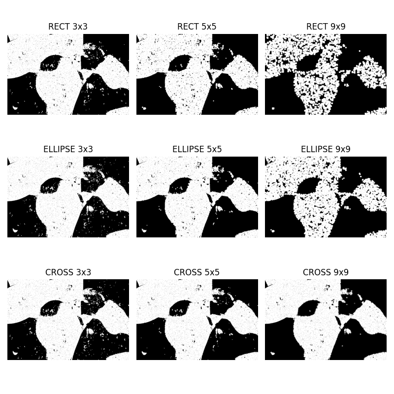
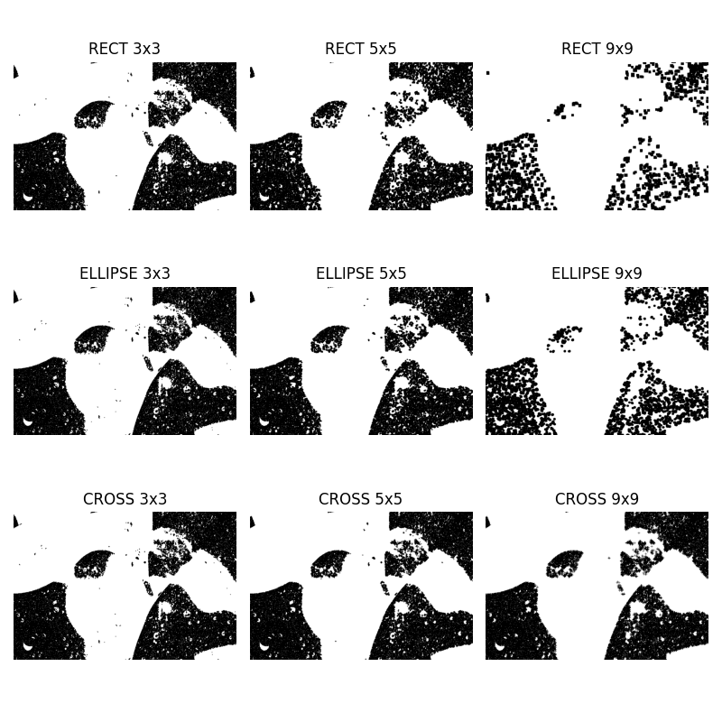
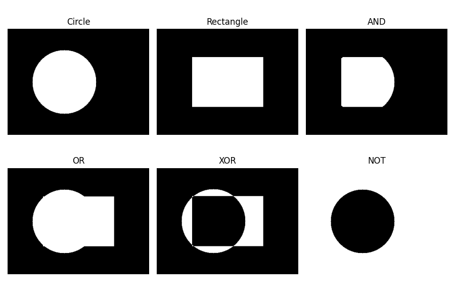
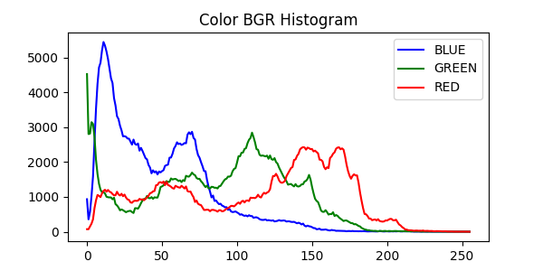
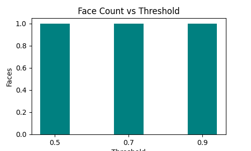
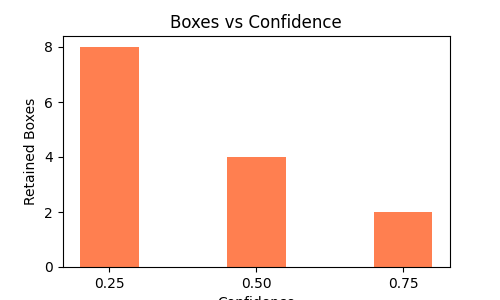
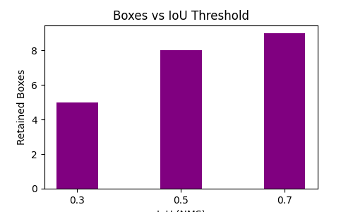
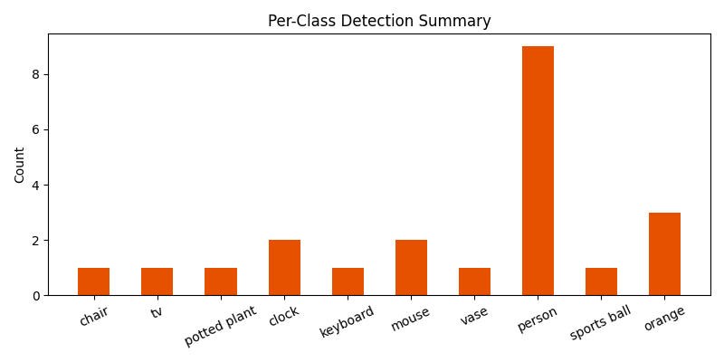

# Computer Vision: Classical Image Processing to Real-Time Object Detection

<p align="center">
  <strong>OpenCV | YuNet | YOLOv8 | Deep Learning | Real-Time Computer Vision</strong>
</p>

<p align="center">
  An end-to-end Computer Vision pipeline combining classical image processing techniques with deep learning-based face and object detection.
</p>

---

## Overview

This project demonstrates an integrated Computer Vision system that combines traditional image processing techniques with modern deep learning-based detection models.

The pipeline starts with image preprocessing techniques such as morphological operations, bitwise operations, histogram analysis, and brightness and contrast adjustment. It then applies YuNet for face detection and YOLOv8-Nano for multi-class object detection.

In the final stage, both detection models are integrated into a unified pipeline to perform face and object detection on the same camera stream.

The project also explores image noise removal, facial landmark localization, privacy-preserving face blurring, detection threshold optimization, and real-time performance benchmarking.

## Project Objectives

- Understand classical image processing techniques using OpenCV.
- Implement erosion, dilation, opening, and closing.
- Apply bitwise operations for image masking and region extraction.
- Analyze grayscale and color image histograms.
- Improve image brightness and contrast.
- Implement face detection using the YuNet ONNX model.
- Detect facial landmarks and confidence scores.
- Apply Gaussian blur for face anonymization.
- Implement object detection using YOLOv8-Nano.
- Experiment with confidence and IoU thresholds.
- Build a unified face and object detection pipeline.
- Compare detection performance using FPS benchmarking.

## Technology Stack

| Category | Technology | Purpose |
|---|---|---|
| Programming Language | Python | Core implementation |
| Computer Vision | OpenCV 5.0.0 | Image processing and face detection |
| Deep Learning | YOLOv8-Nano | Multi-class object detection |
| Face Detection | YuNet | Face localization and landmarks |
| Numerical Computing | NumPy | Image arrays and matrix operations |
| Data Analysis | Pandas | Results comparison |
| Visualization | Matplotlib | Images, histograms and charts |
| Model Format | ONNX | YuNet pretrained model |
| Deep Learning Framework | PyTorch | YOLO inference backend |
| Development Environment | Jupyter Notebook | Interactive implementation |

## Project Architecture

The complete system is divided into five major tasks.

```text
                 IMAGE / VIDEO INPUT
                         |
                         v
              CLASSICAL IMAGE PROCESSING
                         |
          +--------------+--------------+
          |              |              |
          v              v              v
      Morphology      Bitwise       Histograms
          |          Operations    and Enhancement
          |              |              |
          +--------------+--------------+
                         |
                         v
                 FACE DETECTION
                       YuNet
                         |
                         v
                 Facial Landmarks
                 Bounding Boxes
                         |
                         v
                OBJECT DETECTION
                    YOLOv8n
                         |
                         v
                Object Classification
                 Bounding Boxes
                         |
                         v
                INTEGRATED PIPELINE
                         |
                         v
                FPS BENCHMARKING
                         |
                         v
                 FINAL RESULTS
```

## Task 1: Image Processing & Morphological Operations

This task explores fundamental image processing operations using OpenCV.

### Implementations

- Image loading and visualization.
- Grayscale image conversion.
- Binary thresholding.
- Erosion.
- Dilation.
- Morphological opening.
- Morphological closing.
- Salt-and-pepper noise generation.
- Kernel shape and size comparison.

### Kernel Comparison

The following structuring element shapes and sizes are evaluated:

| Kernel Shape | Kernel Sizes |
|---|---|
| RECT | 3×3, 5×5, 9×9 |
| ELLIPSE | 3×3, 5×5, 9×9 |
| CROSS | 3×3, 5×5, 9×9 |

### Key Findings

- Erosion reduces foreground regions and removes small bright noise.
- Dilation expands foreground regions and fills small gaps.
- Opening removes small foreground noise while preserving larger shapes.
- Closing fills small holes and gaps within foreground regions.

A 5×5 elliptical kernel produced a useful balance between noise removal and preservation of object boundaries in the tested binary image.

### Visualization






---

## Task 2: Bitwise Operations & Image Histograms

This task focuses on logical image manipulation and image intensity analysis.

### Bitwise Operations

The following operations are implemented:

| Operation | Function | Purpose |
|---|---|---|
| AND | `cv2.bitwise_and()` | Extract overlapping regions |
| OR | `cv2.bitwise_or()` | Combine image regions |
| XOR | `cv2.bitwise_xor()` | Identify different regions |
| NOT | `cv2.bitwise_not()` | Invert pixel values |

### Practical Applications

- Circle and rectangle binary mask creation.
- Region of Interest (ROI) extraction.
- Circular masking on a workplace image.
- Simple watermark overlay using bitwise OR.

### Histogram Analysis

The project evaluates:

- Grayscale histogram.
- Blue channel histogram.
- Green channel histogram.
- Red channel histogram.
- Brightness adjustment.
- Contrast adjustment.

### Brightness and Contrast Transformation

The following mathematical relationship is used:

\[
g(x,y)=\alpha f(x,y)+\beta
\]

Where:

- `alpha` controls contrast.
- `beta` controls brightness.
- `f(x,y)` represents the original pixel value.
- `g(x,y)` represents the adjusted pixel value.

### Experimental Parameters

| Configuration | Alpha | Beta |
|---|---:|---:|
| Original | 1.0 | 0 |
| Bright / High Contrast | 1.5 | 30 |
| Dark / Low Contrast | 0.7 | -30 |

### Key Findings

Histogram analysis helps understand the distribution of image intensities.

A narrow histogram may indicate low contrast, while values concentrated near 0 or 255 may indicate shadow or highlight clipping.






---

## Task 3: Face Detection Using YuNet

YuNet is used to identify human faces in static images and webcam frames.

The model is integrated through OpenCV's `FaceDetectorYN` API.

### Implementations

- Load pretrained YuNet ONNX weights.
- Detect faces in portrait images.
- Detect faces in different poses.
- Draw face bounding boxes.
- Display five facial landmarks.
- Display detection confidence scores.
- Perform real-time webcam face detection.
- Compare detection score thresholds.
- Apply Gaussian blur for face privacy.

### Facial Landmark Detection

YuNet provides five facial landmark locations:

1. Right eye.
2. Left eye.
3. Nose tip.
4. Right mouth corner.
5. Left mouth corner.

### Test Scenarios

The detector is evaluated on:

- Front-facing portrait.
- Side-profile face.
- Face with sunglasses.
- Group photograph.

### Confidence Threshold Experiment

| Score Threshold | Expected Behaviour |
|---|---|
| 0.50 | Accepts more candidate faces |
| 0.70 | Balanced detection threshold |
| 0.90 | More conservative face detection |

A lower threshold may increase recall but can introduce false positives. A higher threshold may reduce false detections but can miss difficult faces.

### Privacy Application

Gaussian Blur is applied only to detected face regions while keeping the remaining image unchanged.

### Key Findings

YuNet provides a lightweight approach for face localization and facial landmark detection. Its performance depends on face orientation, image quality, lighting, and threshold configuration.




---

## Task 4: Object Detection Using YOLOv8

This task implements general object detection using the pretrained YOLOv8-Nano model.

The model is trained on the COCO dataset and supports 80 object categories.

### Implementations

- Load pretrained YOLOv8-Nano weights.
- Detect objects in static photographs.
- Display bounding boxes.
- Display object class labels.
- Display detection confidence scores.
- Perform webcam object detection.
- Compare confidence thresholds.
- Compare IoU thresholds.
- Calculate Intersection over Union.
- Generate per-class detection statistics.

### Confidence Threshold Experiment

| Confidence | Behaviour |
|---|---|
| 0.25 | Retains more candidate detections |
| 0.50 | Applies a moderate confidence requirement |
| 0.75 | Retains more confident predictions |

### IoU Threshold Experiment

The following IoU values are compared:

`0.30`, `0.50`, `0.70`

Intersection over Union (IoU) measures the overlap between two bounding boxes.

\[
IoU = \frac{\text{Area of Intersection}}{\text{Area of Union}}
\]

Non-Maximum Suppression (NMS) removes overlapping duplicate detections based on confidence and the selected IoU threshold.

A lower IoU threshold applies more aggressive suppression, while a higher threshold can retain more overlapping boxes.

### Per-Class Detection Analysis

The notebook collects object detection counts across multiple sample photographs and generates a bar chart of detected COCO classes.

### Key Findings

YOLOv8-Nano provides a balance between inference speed and object detection capability.

Its performance depends on image resolution, object size, lighting conditions, occlusion, and hardware resources.








---

## Task 5: Integrated Real-Time Computer Vision Pipeline

The final task combines classical image processing, YuNet face detection, and YOLOv8 object detection.

### Pipeline Features

- Webcam frame acquisition.
- Optional morphological preprocessing.
- YuNet face detection.
- YOLOv8 object detection.
- Combined bounding box visualization.
- Face landmarks and confidence scores.
- Object class labels.
- Real-time performance measurement.

### Detection Visualization

| Component | Annotation |
|---|---|
| YuNet | Green bounding boxes |
| Facial Landmarks | Red landmark points |
| YOLOv8 | Red object bounding boxes |
| Object Labels | Class name and confidence |
| Performance | FPS information |

### Morphological Pre-Cleaning

The notebook generates a noisy image and applies morphological opening to examine the effect of noise removal.

It compares YOLO detection results before and after preprocessing.

This experiment helps evaluate whether classical image preprocessing improves detection results. Morphological processing is optional because excessive preprocessing may remove useful visual information.

### FPS Benchmarking

Performance is measured over 100 repeated inference iterations using the same test frame.

The following configurations are evaluated:

1. YuNet face detection only.
2. YOLOv8 object detection only.
3. Combined YuNet and YOLOv8 pipeline.

### Recorded Benchmark Results

The following values are from the saved notebook execution:

| Configuration | Measured FPS |
|---|---:|
| YuNet Only | 22.6 |
| YOLOv8 Only | 16.4 |
| Combined Pipeline | 9.3 |

The combined pipeline runs slower because both detection models process the same frame.

These measurements represent one execution environment. FPS may vary depending on hardware, camera resolution, and system load.


---

## Dataset & Pretrained Models

The project uses sample images for classical image processing, face detection, and object detection experiments.

### Image Dataset

Place the following images inside `data/images/`:

| Image | Purpose |
|---|---|
| `texture_surface.jpg` | Grayscale processing and morphology |
| `indoor_desk.jpg` | ROI extraction and object detection |
| `fruits.jpg` | Color and grayscale histograms |
| `portrait_face.jpg` | Frontal face detection and privacy blur |
| `profile_face.jpg` | Side-profile face detection |
| `group_people.jpg` | Multiple face and object detection |
| `stuff.jpg` | YOLO per-class detection summary |
| `faces/face_sunglasses.png` | Partially occluded face detection |

### Pretrained Models

**1. YuNet Face Detector**

Model: `face_detection_yunet_2023mar.onnx`

Source: [OpenCV Zoo](https://github.com/opencv/opencv_zoo/tree/main/models/face_detection_yunet)

**2. YOLOv8-Nano**

Model: `yolov8n.pt`

Source: [Ultralytics Assets](https://github.com/ultralytics/assets/releases)

Pretrained on the COCO dataset with 80 object categories.

---

## Project Structure

```text
CV_PR3/
│
├── CV_PR3.ipynb
├── CV_PR3.html
├── README.md
├── requirements.txt
│
├── data/
│   ├── images/
│   │   ├── texture_surface.jpg
│   │   ├── indoor_desk.jpg
│   │   ├── fruits.jpg
│   │   ├── portrait_face.jpg
│   │   ├── profile_face.jpg
│   │   ├── group_people.jpg
│   │   ├── stuff.jpg
│   │   └── faces/
│   │       └── face_sunglasses.png
│   │
│   └── models/
│       ├── face_detection_yunet_2023mar.onnx
│       └── yolov8n.pt
│
└── plots/
    ├── morphology_grid.png
    ├── opening_kernel_grid.png
    ├── closing_kernel_grid.png
    ├── bitwise_grid.png
    ├── masked_overlay.png
    ├── grayscale_histogram.png
    ├── colour_histograms.png
    ├── histogram_comparison.png
    ├── face_detection_comparison.png
    ├── face_threshold_comparison.png
    ├── yolo_detections.png
    ├── yolo_confidence_comparison.png
    ├── yolo_iou_comparison.png
    ├── yolo_class_summary.png
    ├── fps_comparison.png
    └── results_table.png
```

## Installation & Setup

### 1. Clone the Repository

```bash
git clone <YOUR_GITHUB_REPOSITORY_URL>
cd CV_PR3
```

### 2. Create a Virtual Environment

```bash
python -m venv .venv
```

Activate on Windows:

```powershell
.\.venv\Scripts\Activate.ps1
```

### 3. Install Dependencies

```bash
pip install -r requirements.txt
```

The required packages include:

```bash
pip install opencv-python numpy matplotlib pandas ultralytics jupyter
```

Use a compatible OpenCV installation that provides the `FaceDetectorYN_create` API. Avoid installing multiple conflicting OpenCV distributions in the same environment.

### 4. Download Model Weights

Place the YuNet ONNX model and YOLOv8-Nano weights inside:

```text
data/models/
```

Use the official model sources listed above.

### 5. Launch Jupyter Notebook

```bash
jupyter notebook CV_PR3.ipynb
```

Run the notebook cells sequentially.

Ensure that all image files and pretrained models are available at the specified paths before executing the corresponding tasks.

### 6. Run Webcam Demonstrations

Execute the following functions locally:

**YuNet Face Detection**

```python
open_yunet_webcam()
```

**YOLOv8 Object Detection**

```python
open_yolo_webcam()
```

**Integrated Face & Object Detection**

```python
open_integrated_webcam()
```

Press `q` to stop a live webcam demonstration.

---

## Applications

The techniques implemented in this project can be applied to:

- Smart surveillance systems.
- Workplace monitoring.
- Face localization and privacy filtering.
- Traffic and vehicle detection.
- Retail object analytics.
- Industrial image inspection.
- Real-time video analytics.
- Image enhancement and preprocessing.

## Limitations

- Face detection accuracy depends on lighting, pose, and visibility.
- YuNet may miss heavily occluded or very small faces.
- YOLOv8-Nano may struggle with small or partially hidden objects.
- Detection thresholds influence false positives and missed detections.
- Morphological preprocessing can remove useful image details if applied incorrectly.
- Combined detection requires more computation than running either detector independently.
- Webcam FPS varies across different hardware configurations.

## Future Improvements

- Add object tracking using ByteTrack or DeepSORT.
- Implement video file processing.
- Add real-time detection statistics.
- Compare YOLOv8-Nano with larger YOLO models.
- Optimize inference using GPU acceleration.
- Build an interactive Streamlit dashboard.
- Integrate a FastAPI backend for deployment.
- Add configurable detection parameters.

## Conclusion

This project demonstrates how classical Computer Vision and deep learning techniques can work together in a unified detection system.

Morphological operations, bitwise manipulation, and histogram analysis provide a foundation for image preprocessing and enhancement. YuNet adds lightweight face detection and landmark localization, while YOLOv8-Nano provides multi-class object detection.

The integrated pipeline combines both detectors and evaluates their computational performance through FPS benchmarking.

Overall, the project provides practical implementation experience in **image processing, OpenCV, deep learning, face detection, object detection, and real-time Computer Vision pipeline development**.

---

## Tools & Technologies

Python · OpenCV · NumPy · Pandas · Matplotlib · YuNet · ONNX · YOLOv8 · PyTorch · Jupyter Notebook
